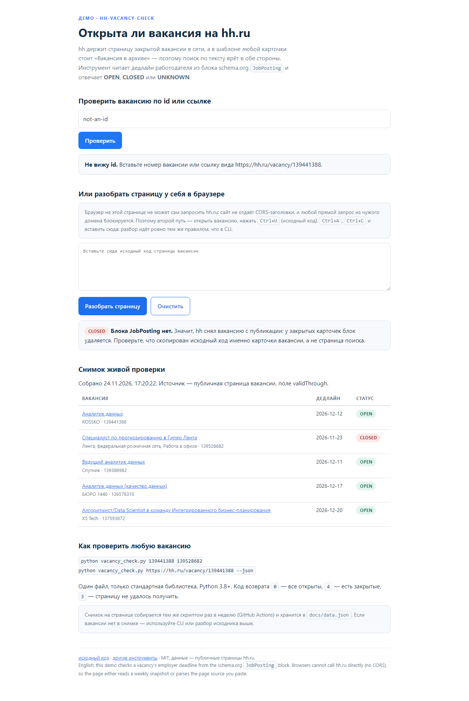

# hh-vacancy-check

[](https://github.com/basovdanil/hh-vacancy-check/actions/workflows/tests.yml)

**English** · [Русский](README.md)

<p align="center">
  
</p>

Checks whether hh.ru vacancies are still open, without logging in and without an API token.

**Browser demo:** https://basovdanil.github.io/hh-vacancy-check/ — paste a vacancy id or the page
source and get `OPEN` or `CLOSED`.

<p align="center">
  
</p>

## Why it exists

hh keeps an archived vacancy page online, and the page template always contains the phrase
«Вакансия в архиве» — so a plain text search reports every posting as archived. The reliable signal
is the schema.org `JobPosting` block: its `validThrough` field is the employer's deadline, and hh
strips the block from postings it has closed.

```bash
python vacancy_check.py 139441388 139528682 139578310
```

```
OPEN      139441388  2026-12-12  Аналитик данных
CLOSED    139528682  2026-11-23  Специалист по прогнозированию в Гипер Лента
                     validThrough has passed
OPEN      139578310  2026-12-17  Аналитик данных (качество данных)
```

Exit code `4` — at least one vacancy is closed, so it can gate a script that collects postings.

## Usage

```
python vacancy_check.py <id|url> [<id|url> ...] [--json]
python vacancy_check.py --from-file vacancies.txt
```

- accepts bare ids and full URLs (`https://hh.ru/vacancy/139441388?query=x`);
- `--from-file` reads a text file: one id or URL per line, blank lines and `#` comments are skipped,
  duplicates collapse, broken lines are reported (`exit 2`);
- `--json` prints one object per vacancy to stdout, no colour, no progress;
- standard library only, Python 3.8+.

`vacancies.txt` for a job search looks like this:

```
# отклики этой недели
139441388
https://hh.ru/vacancy/139528682?query=1
# старые, проверить перед письмом
137593872
```

## Use in CI as a GitHub Action

The repository is a composite action: fail a workflow when a posting you depend on is closed.

```yaml
- uses: basovdanil/hh-vacancy-check@v1
  id: vacancy
  with:
    vacancies: "139441388 139528682"   # ids or full URLs, space separated
    json: "false"                      # "true" for machine-readable output

- run: echo '${{ steps.vacancy.outputs.result }}'
```

Exit code `4` fails the step when at least one vacancy is closed, so a scheduled job can stop a
scraper or a report that references a dead posting. `actions/setup-python` is included in the action,
no extra step needed.

## Exit codes

| Code | Meaning |
| --- | --- |
| `0` | every vacancy is open |
| `2` | bad arguments |
| `3` | the page could not be fetched or parsed |
| `4` | at least one vacancy is closed or unknown |

## How the check is done

1. Fetch the vacancy page with a normal browser User-Agent.
2. Find the `application/ld+json` block with `"@type": "JobPosting"`.
3. Compare `validThrough` with the current time.
4. No block at all means the posting is closed or removed; a block without `validThrough` is
   reported as `unknown`, not as open.

No cookies, no login, no private endpoints — one public page per vacancy.

## Tests

```
python -m unittest discover -s tests
```

16 tests on saved HTML fixtures: open/expired/missing-deadline/archived pages, broken JSON-LD,
non-JobPosting blocks, id extraction from URLs, and every exit code. The test suite never touches
the network.

## Scope

hh.ru only, and only the public page. Rate: one request per vacancy with no parallelism; the site
may throttle a burst of requests, so the tool is meant for dozens of links, not thousands.

It reports the employer's deadline, not the employer's intent: a vacancy can be `OPEN` and still be
filled.

---

More projects: [github.com/basovdanil](https://github.com/basovdanil) · write-ups: [portfolio](https://basovdanil.github.io/portfolio/)
