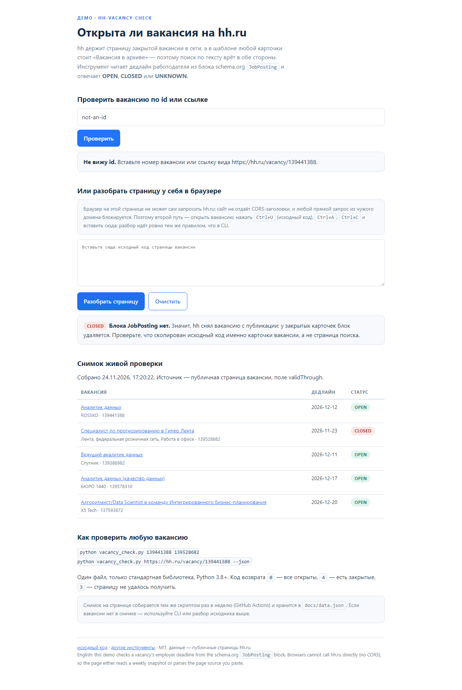

# hh-vacancy-check

[](https://github.com/basovdanil/hh-vacancy-check/actions/workflows/tests.yml)

[English](README.en.md) · **Русский**

<p align="center">
  
</p>

Проверяет, открыта ли вакансия на hh.ru — без входа в аккаунт и без токена API.

**Демо в браузере:** https://basovdanil.github.io/hh-vacancy-check/ — введите id вакансии или
вставьте исходный код страницы, ответ будет `OPEN` или `CLOSED`.

<p align="center">
  
</p>

## Зачем

hh держит страницу закрытой вакансии доступной, и в шаблоне страницы всегда есть фраза
«Вакансия в архиве». Поэтому поиск по тексту отвечает «в архиве» на любой вакансии. Надёжный
признак — блок schema.org `JobPosting`: поле `validThrough` это дедлайн работодателя, а у
закрытых вакансий блок hh убирает.

```bash
python vacancy_check.py 139441388 139528682 139578310
```

```
OPEN      139441388  2026-12-12  Аналитик данных
CLOSED    139528682  2026-11-23  Специалист по прогнозированию в Гипер Лента
                     validThrough has passed
OPEN      139578310  2026-12-17  Аналитик данных (качество данных)
```

Код возврата `4` — хотя бы одна вакансия закрыта, это годится как условие в скрипте сбора.

## Запуск

```
python vacancy_check.py <id|url> [<id|url> ...] [--json]
```

- принимает и голые id, и полные ссылки (`https://hh.ru/vacancy/139441388?query=x`);
- `--json` печатает по объекту на вакансию, без цвета и прогресса;
- только стандартная библиотека, Python 3.8+.

## В CI как GitHub Action

Репозиторий — composite action: роняет workflow, когда вакансия, на которую он ссылается, закрыта.

```yaml
- uses: basovdanil/hh-vacancy-check@v1
  id: vacancy
  with:
    vacancies: "139441388 139528682"   # id или полные ссылки через пробел
    json: "false"                      # "true" — машиночитаемый вывод

- run: echo '${{ steps.vacancy.outputs.result }}'
```

Код возврата `4` роняет шаг, если хотя бы одна вакансия закрыта: планировщик может остановить
сборщик или отчёт, который ссылается на снятую вакансию. `actions/setup-python` внутри действия,
отдельный шаг не нужен.

## Коды возврата

| Код | Значение |
| --- | --- |
| `0` | все вакансии открыты |
| `2` | неверные аргументы |
| `3` | страницу не удалось получить или разобрать |
| `4` | хотя бы одна вакансия закрыта или в неопределённом состоянии |

## Как проверяется

1. Запрос страницы вакансии с обычным User-Agent браузера.
2. Поиск блока `application/ld+json` с `"@type": "JobPosting"`.
3. Сравнение `validThrough` с текущим временем.
4. Нет блока — вакансия закрыта или снята; блок без `validThrough` — состояние `unknown`,
   а не «открыта».

Ни cookie, ни логина, ни приватных адресов: одна публичная страница на вакансию.

## Тесты

```
python -m unittest discover -s tests
```

16 тестов на сохранённых HTML: открытая, просроченная, без дедлайна, архивная; битый JSON-LD,
чужие типы блоков, извлечение id из ссылки, все коды возврата. Сеть в тестах не используется.

## Границы

Только hh.ru и только публичная страница. Один запрос на вакансию, без параллельности: сайт
может ограничить поток запросов, инструмент рассчитан на десятки ссылок, а не тысячи.

Показывается дедлайн работодателя, а не намерение: вакансия может быть `OPEN` и уже закрытой
по факту найма.

---

Другие проекты: [github.com/basovdanil](https://github.com/basovdanil) · разборы с числами: [portfolio](https://basovdanil.github.io/portfolio/)
